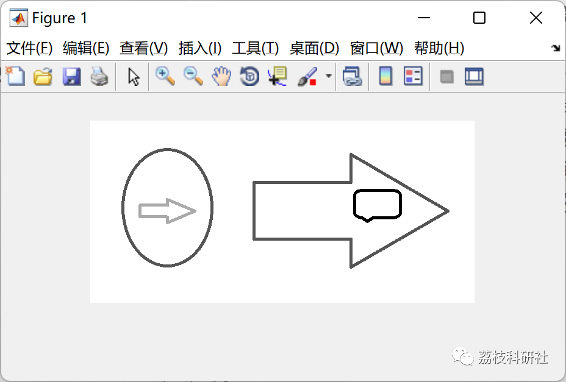

# Image Segmentation: Evolutionary Clustering Technique Based on Genetic Algorithm for Color Image Segmentation (Matlab Code Implementation)

💥💥💥💞💞💞 Welcome to this blog❤️❤️❤️💥💥💥
🏆 Bloggers' Advantages: 🌞🌞🌞 The content of the blog strives for rigorous thinking and clear logic to facilitate readers.
⛳️ Mantra: A journey of a thousand miles is begun with a single step.
Litchi Research Society
Code Collection: Power Systems, Intelligent Algorithms and Applications, Neural Network Prediction, Path Planning, Optimized Scheduling, Workshop Scheduling, Image Processing, Signal Processing...
🎁 Special Section Link: ​
🌈🌈🌈🌟🌟🌟 Electrical Code Drone and Physical Application Path Planning Intelligent Algorithms and Their Applications Optimized Scheduling Neural Network Prediction Workshop Scheduling Image Processing Romantic Her Signal Processing Mathematical Modelling My Thoughts Speech Processing Complete Code Matters
💥1 Overview
Image segmentation is one of the primary issues in image analysis and pattern recognition, and also one of the classic problems in image processing, which is an important component of image analysis and pattern recognition systems and determines the final analysis quality and the discrimination results of pattern recognition. In other words, image segmentation refers to separating different regions with special significance in an image and making these regions mutually non-overlapping, and each region should meet specific consistency conditions.
Since color images provide more rich information than grayscale images, color image processing is receiving increasing attention. Color image segmentation is an important issue in color image processing, which can be seen as the application of grayscale image segmentation technology in various color spaces. To enable researchers in this field to have a comprehensive understanding of current various color image segmentation methods, this paper conducts color image segmentation based on genetic algorithms (clustering).
📚2 Running Results
Using Genetic Algorithm-Based Image Segmentation Evolutionary Clustering
Objective Function: Within the cluster distance
Using distance measurement
Measurement of image features: Three features (R, G, B values)
It is also composed of matrix-based input sample examples with 15 and 2 features
🎉3 References
[1][1] Lin Kaiyan, Wu Junhui, Xu Lihong. Overview of Color Image Segmentation Methods [J]. Journal of Chinese Graphic and Graphics Society: A Series, 2005, 10(1): 1-10
[2] Selva (2022). Color Image Segmentation Using Genetic Algorithm (Clustering)
👨‍💻4 Matlab Code to Implement
Click the left bottom corner of the article to read more.

## Images

<!-- PAYMENT_BLOCK -->

## Get this dataset

- Payment link (Stripe): [Buy now](https://buy.stripe.com/3cs8yP7sY87d0vu9AB)
- Payment QR code: 

<!-- /PAYMENT_BLOCK -->
